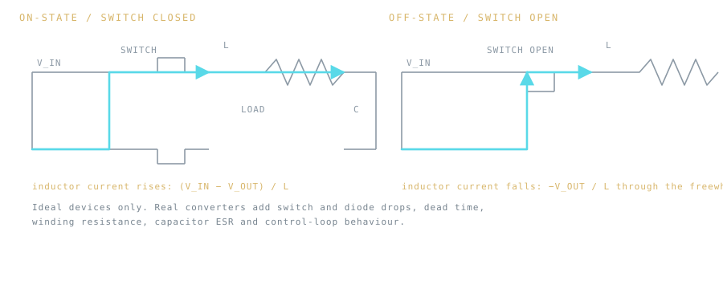
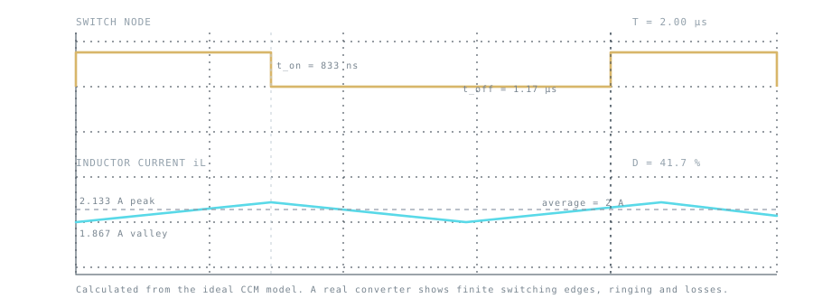

## Two switch states, one inductor

An ideal buck converter transfers energy through an inductor while the switch alternates between two states. During the **on** interval, the inductor sees `Vin − Vout`; during the **off** interval in the ideal freewheel path, it sees `−Vout`. Inductor current ramps up and down rather than changing instantaneously.

*Ideal switches only. The drawing shows the two conduction paths; it is not a schematic of a fabricated board.*

Two intervals make the converter work:

- **Switch closed.** The input is connected to the inductor through the switch. Current rises at `(Vin − Vout)/L` while energy is stored in the magnetic field.
- **Switch open.** The input is disconnected, and the inductor current continues through the freewheel path. Current falls at `Vout/L`.

Because the inductor cannot change its current instantly, the output keeps receiving energy during both intervals. That is the whole idea: the switch chops, the inductor and capacitor smooth.

In steady-state **continuous conduction mode (CCM)**, volt-second balance across the inductor gives the familiar ideal conversion relation:

$$
D ≈ Vout / Vin
$$

This relationship assumes ideal switches and steady-state CCM. It is not a universal duty command for a physical converter. Switch and diode drops, winding resistance, dead time, control limits, and the selected controller change the real requirement. A single efficiency percentage does not specify those losses or provide a general duty-cycle correction.

## Inductor ripple from the slopes

The on-state current rise is the on-state voltage divided by inductance, multiplied by on-time. With `T = 1/fsw` and `ton = D·T`:

$$
ΔIL = (Vin − Vout)·D / (L·fsw) = Vout·(1 − D) / (L·fsw)   [ideal CCM]
$$

The two expressions agree when `D = Vout/Vin`. The average inductor current equals the load current in the ideal steady-state model, so the ripple-centered peak and valley estimates are:

$$
IL,peak ≈ Iout + ΔIL/2,     IL,valley ≈ Iout − ΔIL/2
$$

CCM requires a nonnegative valley current. Setting the valley to zero gives the ideal boundary inductance:

$$
Lcrit ≈ Vout·(1 − D) / (2·fsw·Iout)
$$

Below this load boundary, a diode-based buck's inductor current reaches zero for part of the cycle. In DCM, the ideal conversion ratio depends on load and inductance as well as input/output voltage; the simple CCM duty relation is no longer the complete model.

## Reading the waveforms

*Calculated from the ideal CCM relations below, not measured. Switching edges, ringing, losses and control-loop behaviour are absent by construction.*

Three things are worth noticing in that figure:

- The switch node is high for `t_on` and low for `t_off`; their ratio is the duty cycle.
- The inductor current is a triangle centred on the load current, not a copy of the switch waveform. It cannot jump, which is why the output keeps receiving current while the switch is open.
- Peak current sits above the average and valley current below it. A real inductor must saturate above the peak, not above the average.

## Worked ideal CCM estimate

Consider an illustrative operating point: `Vin = 12 V`, `Vout = 5 V`, `fsw = 500 kHz`, `L = 22 µH`, and `Iout = 2 A`.

- Ideal CCM duty: `5/12 ≈ 41.7%`.
- Inductor ripple: approximately `0.265 A peak-to-peak`.
- CCM-model peak and valley: approximately `2.133 A` and `1.867 A`.
- Critical inductance at this load: approximately `1.46 µH`, below the illustrative `22 µH`.

These are **calculated model outputs**, not measured results. They omit switch and diode drops, inductor DCR, core loss, capacitor ESR, layout parasitics, control-loop dynamics, temperature, and transient behavior. The actual duty and waveforms depend on the chosen controller and hardware.

## Efficiency belongs in the power estimate

If a designer supplies an efficiency assumption `η`, it can estimate input power from output power:

$$
Pin ≈ Vout·Iout/η,     Ploss ≈ Pin − Vout·Iout
$$

That is a power-budget estimate. It is **not** a universal correction to `D = Vout/Vin`. Real duty depends on the individual loss mechanisms and the control loop.

## Try the numbers yourself

Two ways to check this reasoning, both interactive and both ideal:

- The [buck-converter explorer](/tools/buck-converter.html) plots the PWM switch node and the inductor-current ramp for the operating point you choose, and flags when the CCM boundary is crossed.
- The [PWM signal laboratory](/tools/pwm-lab.html) isolates the switching waveform itself, so you can see how duty and frequency change timing independently of the power stage.

Use the [RC time constant tool](/tools/rc-time-constant.html) if you want to size an output-filter pole for a given corner frequency. When the valley-current condition is not met, the plot explicitly stops claiming a CCM waveform; the tool does not solve DCM.

## References

- [Texas Instruments, Basic Buck Topology (SLVA257A)](https://www.ti.com/lit/an/slva257a/slva257a.pdf)
- [Texas Instruments, LMR516xx buck converter datasheet](https://www.ti.com/lit/ds/symlink/lmr51606.pdf)
