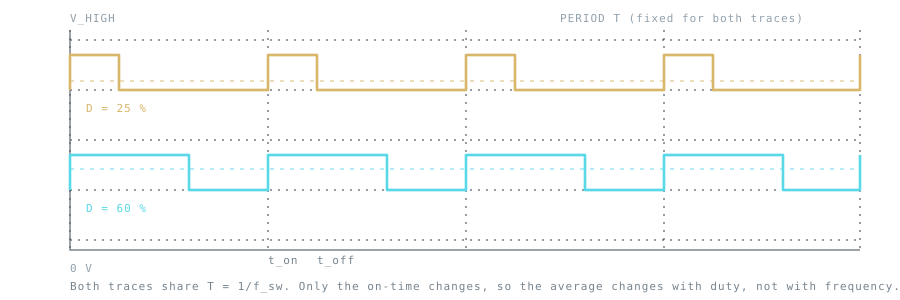

## What a PWM signal controls

Pulse-width modulation (PWM) represents a control command with a repeating digital waveform. The **period** `T` is the time for one cycle, the **frequency** `f` is its reciprocal, and the **duty ratio** `D` is the fraction of a cycle spent in the active state.

$$
f = 1/T,     D = ton/T
$$



*Both traces share the same period. Changing duty moves the falling edge; changing frequency moves the whole pattern.*

For an ideal pulse that switches between zero and `VH`, the time-average at the switching node is `D·VH`. That does **not** mean every load receives a smooth DC voltage: the load, filter, driver, and switching network determine the actual current and voltage.

## Timer counts set the available resolution

A common timer implementation counts through `N` time steps per period and changes the output when the compare count is reached. A useful approximation is:

$$
tstep = T/N,     ΔD ≈ 1/N
$$

The timer clock, prescaler, period register, alignment mode, and hardware buffering determine the exact mapping. More counts per cycle improve duty granularity, but at a fixed timer clock they require a longer period and therefore lower PWM frequency. Microcontroller peripherals differ; use the selected part's reference manual for the precise register equation.

| Change | Benefit | Trade-off |
| --- | --- | --- |
| Increase PWM frequency | Faster control updates; smaller passive components may be possible | Fewer timer counts at a fixed timer clock; higher switching loss in a power stage |
| Increase period counts | Finer duty adjustment | Lower maximum PWM frequency unless the timer clock increases |
| Use buffered compare updates | Avoids malformed mid-cycle pulses | Update timing and synchronization are peripheral-specific |

## A worked timer calculation

Take a timer clocked at 64 MHz with no prescaler and a period register that counts `N = 320` ticks:

- PWM period: `320 / 64 MHz = 5 µs`, which is 200 kHz.
- Duty resolution: `1/320 ≈ 0.31 %` per step.
- A 25 % duty therefore needs a compare value of `0.25 × 320 = 80` ticks.

Halve the period register to `N = 160` and the frequency doubles to 400 kHz, but the duty resolution halves to `1/160 ≈ 0.63 %`. That is the trade-off in one line of arithmetic.

## Small timer example

The following is pseudocode for an up-counter timer whose period register is `periodCounts`. It is not tied to a particular MCU's register layout.

```c
#include <stdint.h>
#include <math.h>

uint32_t pwm_compare_from_duty(float duty, uint32_t periodCounts)
{
    if (duty < 0.0f) duty = 0.0f;
    if (duty > 1.0f) duty = 1.0f;
    return (uint32_t)lroundf(duty * (float)periodCounts);
}
```

A power switch must not be driven directly from a microcontroller pin unless the device and switching conditions explicitly permit it. Gate charge, voltage rating, switching transitions, common-mode behavior, isolation, dead time, and fault shutdown can require a dedicated driver and additional design review.

## When PWM becomes a power-control signal

A PWM pin is only a command. In a converter or motor drive, switching devices, the magnetics, current paths, output filter, controller, and protection all shape the result. A duty update also does not guarantee a proportional output change: the operating mode, input range, control-loop dynamics, saturation, and load matter.

Use a waveform or scope capture only with its actual source and conditions identified. This note is an educational explanation, not a record of a measured PWM experiment.

## Try it

The [PWM signal laboratory](/tools/pwm-lab.html) draws the waveform for the frequency and duty you choose, and reports period, on-time, off-time, average and RMS together so the difference between them is visible.

## References

- [Microchip AN539C: Frequency and Resolution Options for PWM Outputs](https://ww1.microchip.com/downloads/aemDocuments/documents/MCU08/ApplicationNotes/ApplicationNotes/00539c.pdf)
- [Microchip dsPIC33/PIC24 high-speed PWM module reference](https://ww1.microchip.com/downloads/en/DeviceDoc/70000323h.pdf)
